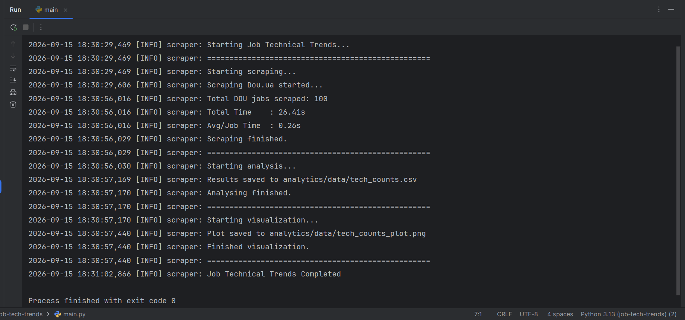
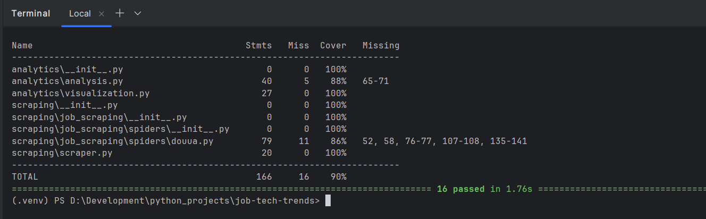
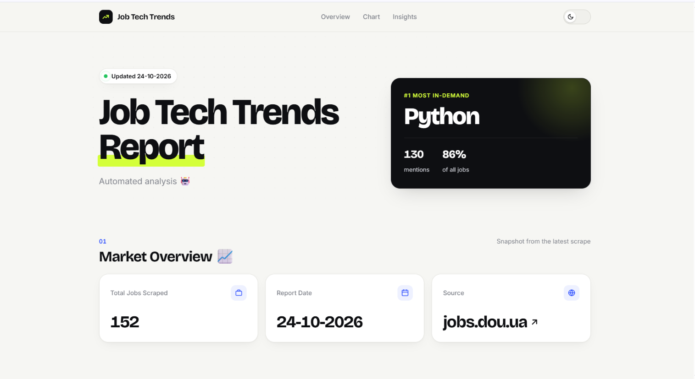

# Job Tech Trends


**[Live demo! 🚀](https://illya-maznitskiy.github.io/job-tech-trends/)**


## Description
Analyze and visualize the most in-demand technologies in the job market.


## Technologies Used
- Python
- Scrapy
- Pandas, ETL
- Matplotlib, Jinja2 (HTML report)
- AI integration (Gemini API)
- Pytest
- Docker
- CI/CD (GitHub Actions, GitHub Pages)


## Features
- Scrape DOU.ua jobs and count the most in-demand technologies.
- Create an HTML report with a chart and an AI market summary (Gemini).
- Update the live demo every Monday (GitHub Actions + Docker).


## Setup
To install the project locally on your computer, execute the following commands in a terminal:
```bash
git clone https://github.com/Illya-Maznitskiy/job-tech-trends.git
cd job-tech-trends
python -m venv venv
venv\Scripts\activate (on Windows)
source venv/bin/activate (on macOS)
pip install -r requirements.txt
```


## Check .env.example
Check [.env.example](.env.example) file  
Create your .env file and set vars by their simple guide


## Run the app
Open the terminal and use the following command:  
(Average execution time: ~0.3 s / job)
```bash
python main.py
```
Note: Google AI models can make mistakes, so double-check responses before relying on, publishing, or otherwise using generated content.


## Run with Docker
Requires [Docker](https://docs.docker.com/get-docker/)

```bash
# Build the image
docker build -t job-tech-trends .

# Run the pipeline
docker run --name job_tech_trends_cont --env-file .env job-tech-trends

# Copy the report out of the container
docker cp job_tech_trends_cont:/app/analytics/data/. ./docker-output

# Remove the container before the next run
docker rm job_tech_trends_cont
```
Then open `docker-output/index.html` in a browser.


## Testing
Test coverage ~ 90%  
Open the terminal and use the following command:
```bash
pytest
flake8
```

## Check the result
Local: open `analytics/data/index.html` in a browser
(after `python main.py`).


# Screenshots

### Logging


### Test Coverage


### Visualization result

